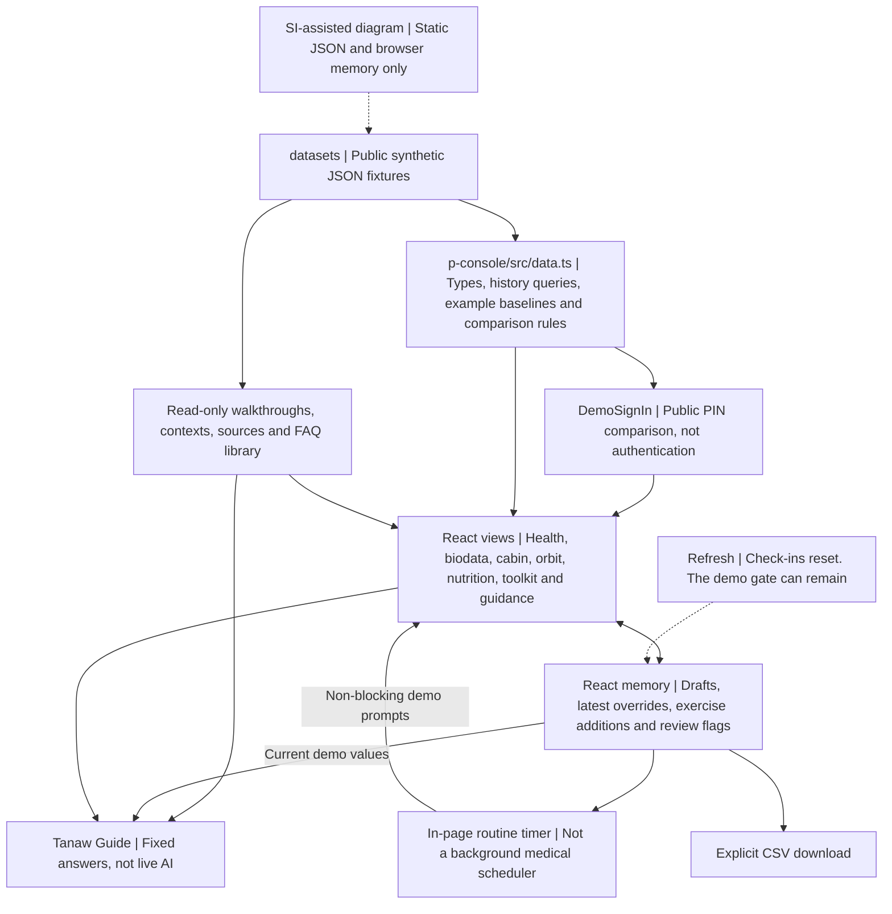
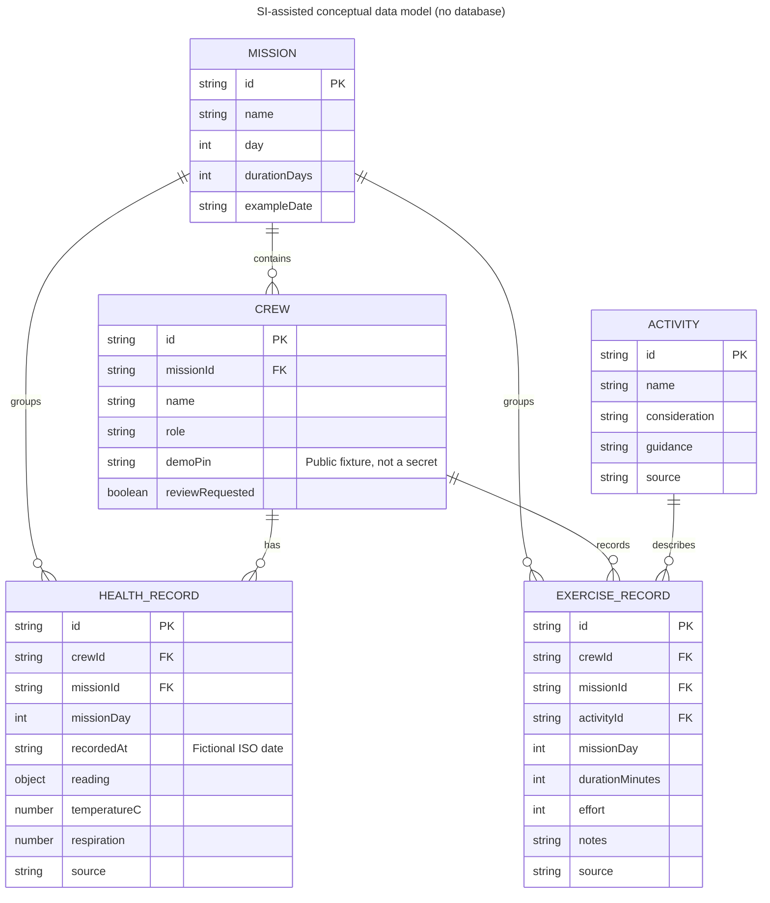

# JSON data architecture and conceptual database mapping

**SI-assisted documentation. No database is installed or connected.** This document shows how the dummy JSON is related; the relational model is an explanatory blueprint, not a deployed schema.

## Current implementation

Editable source: [diagrams/system-architecture.mmd](diagrams/system-architecture.mmd).

## Conceptual entity relationships

**SI-assisted conceptual diagram — no live database.** Editable source: [diagrams/dataset-model.mmd](diagrams/dataset-model.mmd).

## Mapping files to entities

| File                             | Conceptual entity        | Runtime behavior                                              |
| -------------------------------- | ------------------------ | ------------------------------------------------------------- |
| `datasets/mission.json`          | MISSION                  | One immutable reference mission.                              |
| `datasets/crew.json`             | CREW                     | Profile selector and intentionally public sample PINs.        |
| `datasets/health-records.json`   | HEALTH_RECORD            | Histories and initial readings; baseline source.              |
| `datasets/monitoring-rules.json` | Comparison configuration | Example window and difference rules, not clinical thresholds. |
| `datasets/exercise-catalog.json` | ACTIVITY                 | Activity labels and educational context.                      |
| `datasets/exercise-records.json` | EXERCISE_RECORD          | Seed list copied into React state for the demonstration.      |

`reading` is nested JSON with heart rate, systolic/diastolic pressure, sleep, fatigue, mood, and notes. A future relational implementation could normalize these fields, but no such migration is part of this project.

## Keys, order, and provenance

- IDs connect records; names and array indexes are not foreign keys in the files.
- Health history is ordered by mission day, with exactly one fixture per crew/day.
- Fictional `recordedAt` dates describe the example mission, not the real current time.
- Temporary exercise additions use random IDs only for React list identity, not security.
- `synthetic_fixture` and `manual_demo` identify example sources. A manual demo entry is not a live medical sensor record.
- No information is sent to a backend for sign-in or recording, and no JSON file is changed by app interactions.

## What this does not implement

There is no SQL server, schema migration, file upload pipeline, durable storage, session token, credential verifier, encryption scheme, or access-control policy. `tanaworbit-api` is a read-only republish of these JSON files, plus biodata, cabin, orbit, nutrition, and a verify report. It is not that missing production API. The browser demo gate stores only the chosen public profile or role in `sessionStorage`. The public `demoPin` and backend demo codes must **never** be carried into a production authentication design.

For real users, identity, data ownership, retention, consent, access controls, and medical/security validation must be designed separately. A production credential store must not expose PINs in frontend bundles.

## Read-only educational knowledge

`datasets/health-toolkit.json` contains source IDs, walkthrough steps, hazard IDs, context previews, and routine definitions. `datasets/assistant-faq.json` references those sources and names permitted in-app actions. They are bundled frontend content, not medical decision tables or a model training dataset.

`p-console/src/toolkitData.ts` resolves these IDs, formats current demo values into a small number of fixed templates, and selects FAQ responses. Unknown questions do not generate new answers. Source IDs are validated by `scripts/verify-toolkit.mjs`.

Selected context, current-run task acknowledgements, timer deadlines, and dialog messages remain in React memory. Chat messages are cleared when the guide closes. There is no conversation table, server-side scheduler, AI provider, prompt upload, or new persistent store. The ER diagram above covers the core health/exercise fixture relationships, not a deployed database.
